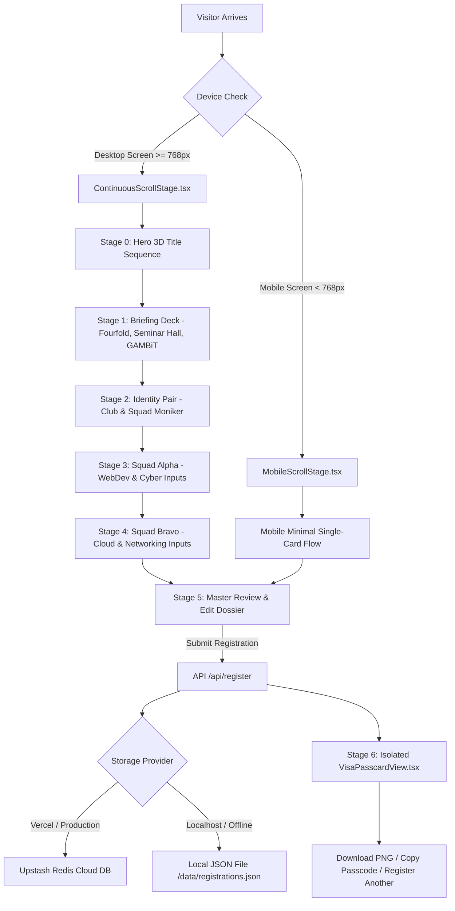

# ♠ CODERLANDS 2026 — TECHNICAL SURVIVAL ARENA
> **Official Registration & Visa Clearance System**  
> **Hosted by TECHNOVATION CLUB** | Tournament Dates: **26th & 27th** | Venue: **Seminar Hall 1 (Raman Block)**

---

## 📖 1. Project Vision & Lore

### What is CoderLands?
**CoderLands** is a high-stakes, inter-club technical tournament designed around a dark, immersive **"Alice in Borderland" meets Royal Playing Cards** gothic aesthetic. Student clubs and societies enter a virtual arena where only the most technically proficient squads survive.

### The Objective
Instead of a standard, boring Google Form, this platform acts as an interactive **"Visa Clearance Terminal"** where teams must:
1. Examine the tournament briefing rules (**Fourfold** Round 1 & **GAMBiT** Round 2).
2. Register their **Club Affiliation** and claim a unique **Squad Moniker**.
3. Enlist **exactly 4 domain specialists**:
   - 🌐 **Web Development**
   - 🛡️ **Cybersecurity**
   - ☁️ **Cloud Computing**
   - 🔌 **Networking**
4. Elect **exactly 1 designated Team Leader**.
5. Review and live-edit all parameters in the **Master Borderland Visa Dossier**.
6. Receive an **Official Borderland Visa Passcard** featuring a unique Team Registration ID (`CL-2026-XXXX`) and Main Quiz Access Passcode (`BORDER-XXXX`), downloadable directly as a high-resolution PNG image.

---

## 🎨 2. Design System & Aesthetics

The visual identity combines **dark neon cyberpunk** with **vintage royal playing card mysticism**.

### Color Palette
- **Deep Void Background**: `#050508` (Obsidian arena)
- **Laser / Neon Crimson**: `#ff113a` & `#d6001c` (Borderland laser accents, glowing rings)
- **Vintage Card Parchment**: `#fbf7ee` & `#f4ede0` (Aged physical card stock)
- **Card Borders & Accents**: `#e6dbc8`, `#8b0000` (Deep blood red foil filigree)
- **Gold / Leader Accent**: `#f59e0b` / `#fbbf24` (Team leader stars and highlights)
- **Card Suit Symbols**: ♠ Spades, ♥ Hearts, ♦ Diamonds, ♣ Clubs, and the inverted Cyrillic **И** emblem representing Technovation.

### Typography
The application loads Google Fonts inside `app/layout.tsx`:
- **`font-baroque` (`Pirata One`)**: Used for imposing gothic headings, card ranks, and "CoderLands" titles.
- **`font-sheepman` (`Cinzel Decorative`)**: Used for ornate royal subtitles, badge stamps, and action buttons.
- **`font-techno` (`Rajdhani`)**: Used for high-tech HUD labels, chapter markers, and status indicators.
- **`font-mono` (`JetBrains Mono`)**: Used for technical data, Team IDs, passcodes, and input fields.

### Custom Component Styling
- **`playing-card-front`**: Physical card look with subtle paper grain texture, red border filigree, and corner suits.
- **`shadow-laser`**: Multi-layered neon red dropshadows (`0 0 25px rgba(255,17,58,0.5)`).
- **`foil-glitter`**: Premium foil reflection effect on cards and master dossier.

---

## 🎬 3. Architecture & Interactive Flow

The application features two distinct rendering modes tailored to user device capabilities:



### Desktop Mode (`components/ContinuousScrollStage.tsx`)
- **Virtual Continuous Scroll**: A multi-thousand pixel virtual scroll canvas governed by Framer Motion's `useScroll` and `useTransform`.
- **Card Deal & Spatial Migration**:
  - Cards begin in the center (dealing from a poker deck).
  - As the user scrolls, earlier cards smoothly scale down, rotate, and migrate to the left and right borders of the screen (`x: -460px` to `+460px`), mimicking physical cards resting on a green-felt table.
  - Clicking any card brings it into instant focus with zero blurred overlays. Resuming scroll automatically dismisses focus and returns the card to its coordinate.
- **Audio Atmosphere**:
  - Synthesized Web Audio API sound effects (`lib/sounds.ts`) for card clicks, laser zaps, and fanfare.
  - Background theme music (`/themesong.mp3` at 25% volume) auto-triggered smoothly upon first user interaction (click, touch, or scroll).
  - Ambient mute/unmute toggle in the top HUD.

### Mobile Mode (`components/MobileScrollStage.tsx`)
- **Minimalist Single-Card Flow**: On smartphone viewports, complex 3-card desktop overlapping is omitted.
- Each section delivers **one clean card at a time** for seamless one-handed touch scrolling.
- Direct input fields are placed right on the front of the cards.

### The Master Review Dossier (Stage 5)
- Displays all 6 entered parameters (Club Name, Squad Moniker, 4 Members with assigned domains, and designated Team Leader).
- **Fully Editable Inline**: If a squad realizes an email typo or wants to swap the Team Leader at the last moment, they can edit right inside the dossier without scrolling back!

### The Visa Clearance Screen (`components/VisaPasscardView.tsx`)
- Triggered immediately upon registration with confetti celebration (`canvas-confetti`).
- **Completely Isolated Screen**: The background long scroll is unmounted/hidden; the user is locked into a clean, zero-scroll single-page view.
- **Direct High-Res PNG Download (`html-to-image`)**:
  - **On Desktop PC**: Bypasses OS share sheets and triggers a direct browser download (`link.click()`) into `Downloads/CoderLands_Visa_CL-2026-XXXX.png`.
  - **On Mobile (iOS/Android)**: Integrates with the native Web Share API (`navigator.share`) allowing instant "Save to Photos" or WhatsApp sharing.
  - **iOS In-App Failsafe**: If opened inside Instagram/Google App on iPhone where file downloads are sandboxed, a tap-and-hold modal is automatically displayed.

---

## 🛡️ 4. Organizer Registry & Administration

A private, secure administrative dashboard is baked into the top navbar:
- **Gatekeeper Authentication**: Click the **"ORGANIZER"** button in the header. Enter:
  - **Organizer ID**: `technoAdmin`
  - **Passkey**: `coderland2k26`
- **Dashboard Capabilities (`components/OrganizerModal.tsx`)**:
  - Live count of confirmed squads against the target (e.g., `12 / 30 Target`).
  - Search/filter across squad moniker, club name, or Team ID.
  - Displays all 4 domain specialists, designated team lead star (`★`), and credentials.
  - **Export CSV (Indian Standard Format)**:
    - Generates a fully formatted spreadsheet with highlighted uppercase headers.
    - Dedicated columns: `REGISTRATION_ID`, `PASSCODE`, `TEAM_NAME`, `CLUB_NAME`, `TEAM_LEAD_NAME`, `WEB_DEV_SPECIALIST`, `CYBER_SPECIALIST`, `CLOUD_SPECIALIST`, `NETWORK_SPECIALIST`, `REGISTRATION_TIME_IST`.
    - Timestamps formatted strictly in Indian Standard Time (`DD-MM-YYYY hh:mm:ss AM/PM`).

---

## 🗄️ 5. Database & Storage Architecture (`lib/db.ts`)

To support instantaneous serverless deployment on **Vercel** (where server filesystems are read-only) while keeping local development seamless, `lib/db.ts` uses a **Cloud-First Hybrid Storage Layer**:

1. **Production (Upstash Redis / Vercel KV)**:
   - When `UPSTASH_REDIS_REST_URL` and `UPSTASH_REDIS_REST_TOKEN` (or `KV_REST_API_URL`) are present, registrations, audit logs, and quiz sync records are stored atomically in Redis via HTTP REST (`@upstash/redis`).
   - Zero cold-start latency, connection pool free, 100% persistent across serverless lambdas.
2. **Local Development (Fallback to Local JSON)**:
   - If Redis environment variables are absent (e.g. offline coding), it automatically writes to:
     - `data/registrations.json`: Complete registration records.
     - `data/quiz_event_teams.json`: Formatted schema ready for live quiz events.
     - `data/audit_log.jsonl`: Append-only Write Ahead Log (WAL).
3. **Concurrency Protection**:
   - An in-memory asynchronous `AsyncMutex` serializes requests to guarantee atomic duplicate checks (e.g. preventing two teams from taking the exact same team name).

---

## 📁 6. Codebase File Structure

```text
CoderLands/
├── app/
│   ├── api/
│   │   ├── register/
│   │   │   └── route.ts          # POST registration & GET organizer records
│   │   └── teams/
│   │       └── route.ts          # Team verification & domain lookup
│   ├── globals.css               # Baroque & cyberpunk styling, custom scrollbars
│   ├── layout.tsx                # Metadata, Google Fonts (Pirata One, Cinzel, Rajdhani)
│   └── page.tsx                  # Root page hosting BorderlandArena & ContinuousScrollStage
├── components/
│   ├── BorderlandArena.tsx       # Ambient 3D lasers, floating dust, Shoji grid
│   ├── ClubEmblem.tsx            # Technovation inverted Cyrillic 'И' emblem
│   ├── ContinuousScrollStage.tsx # Desktop 3D continuous scroll stage & state manager
│   ├── CornerFiligree.tsx        # Royal playing card corner flourishes
│   ├── MobileScrollStage.tsx     # Clean, responsive single-card mobile experience
│   ├── OrganizerModal.tsx        # Admin authentication, live search, Indian CSV export
│   ├── RoyalDirectCard.tsx       # Reusable vintage playing card container
│   └── VisaPasscardView.tsx      # Final isolated passcard, PNG exporter, iOS failsafe
├── data/
│   ├── audit_log.jsonl           # Local WAL event log
│   ├── quiz_event_teams.json     # Sanitized team data for quiz platform
│   └── registrations.json        # Local storage JSON fallback
├── lib/
│   ├── db.ts                     # Hybrid Upstash Redis + Local JSON database manager
│   └── sounds.ts                 # Web Audio API procedural sound synthesizer
├── public/
│   ├── images/                   # Official poster assets and emblems
│   └── themesong.mp3             # Low-volume ambient soundtrack (25% volume)
├── .env.example                  # Template for Upstash Redis / Vercel KV keys
├── idea.md                       # Complete project documentation & guide (this file)
├── package.json                  # Dependencies (Next 14, Framer Motion, Upstash, html-to-image)
├── tailwind.config.ts            # Custom themes, fonts, colors, and shadows
└── tsconfig.json                 # TypeScript strict configuration
```

---

## 🚀 7. Teammate Quickstart Guide

### 1. Clone & Install
```bash
git clone https://github.com/VedisVigourous/Coderland-Registration.git
cd Coderland-Registration
npm install
```

### 2. Run Locally
```bash
npm run dev
```
Open `http://localhost:3000` in your browser. (Local mode runs immediately using `data/registrations.json`).

### 3. Deploying to Vercel
1. Import repository into [vercel.com](https://vercel.com).
2. In Vercel Project Settings ➔ **Storage** ➔ Click **Create Database** ➔ Choose **Upstash for Redis** (Mumbai / South Asia region).
3. Connect it to the project (Vercel automatically sets `UPSTASH_REDIS_REST_URL` & `UPSTASH_REDIS_REST_TOKEN`).
4. Trigger a deployment. Your production site is ready!

---

## 🤝 8. Contribution Guidelines for Teammates
- **Preserve Domain Constraints**: Every squad must always have 4 distinct domains (`Web Development`, `Cybersecurity`, `Cloud`, `Networking`) and exactly 1 team leader.
- **Maintain Minimal Mobile Overhead**: When adding animations, ensure they are conditionally simplified or disabled on mobile (`MobileScrollStage.tsx`) to keep mobile frame rates high.
- **Audio Integrity**: Any added SFX should be routed through `lib/sounds.ts` so the global mute toggle respects user preferences.
- **Clean Commits**: Never track `node_modules/` or `.next/` builds. Keep `.gitignore` intact.

---
*Created with passion by TECHNOVATION CLUB for CoderLands 2026.*
